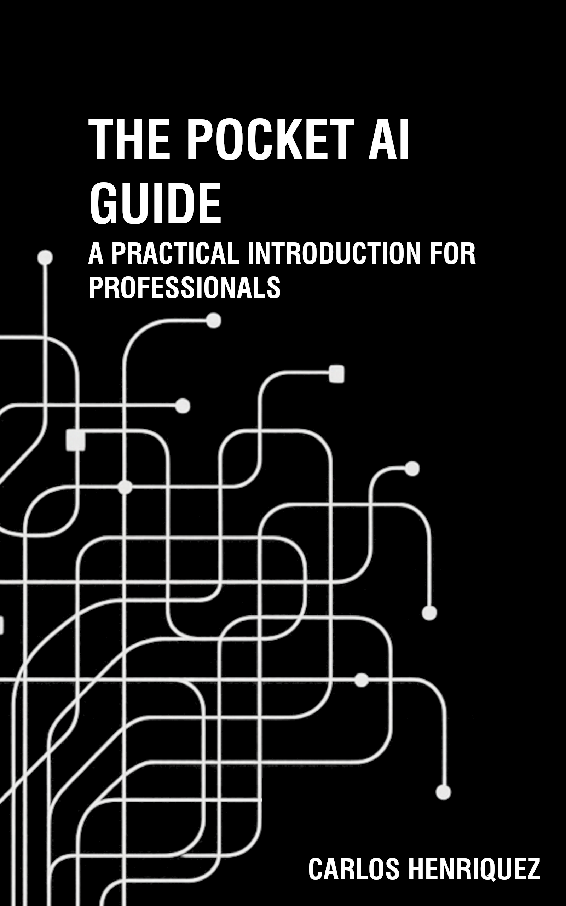

# The Pocket AI Guide

### A Practical Introduction for Professionals

**By Carlos Henríquez**

🌐 **[Visit the official Blank Terminal website](https://blankterminal.no/)**

Welcome to the official companion repository for **The Pocket AI Guide**, the first publication in the Pocket Guide series.

This repository contains supplementary resources designed to help readers explore, practice, and apply the concepts introduced in the book.

**[Get the book on Amazon](https://a.co/d/0dLRzdvu)**

---

## About the Book

*The Pocket AI Guide* introduces artificial intelligence from a practical perspective, helping professionals develop the understanding and confidence needed to work with emerging AI technologies.

The book emphasizes practical application, critical thinking, and informed use of AI.

## Companion Resources

The following resources complement the book and provide
additional opportunities for practical learning.

| Resource | Description | PDF |
|---|---|---|
| 001 — AI Project Kickoff Checklist | 10 questions to ask before starting an AI-assisted project. |[Download PDF](resources/001PAIG_ProjectChecklistv62110.pdf) |
| Resource 02 | Coming soon |5 points to assess the reliability of an output. |[Download PDF](resources/002PAIG_AIOutputVerificationV6210.pdf)|
| Resource 03 | Coming soon |  |
| Resource 04 | Coming soon |  |
| Resource 05 | Coming soon |  |

## How to Use These Resources

Each resource is provided as a PDF document.

Click **View PDF** to open the document in GitHub.
From there, you can read it online or download a copy.

These materials are intended to complement the book,
encourage experimentation, and support practical learning.

## Updates and Feedback

These materials may be revised as AI technologies evolve.

Suggestions, corrections, and feedback are welcome through the repository's **Issues** section.

## About the Author

Carlos Henríquez is an architect, educator, and author based in Norway.

His work explores the practical application of emerging technologies, digital transformation, and responsible technology adoption.

## Copyright and Usage

© 2026 Carlos Henríquez. All rights reserved.

Companion materials are provided for educational use. Specific permissions for reuse and redistribution will be described in the repository's licensing documentation.

